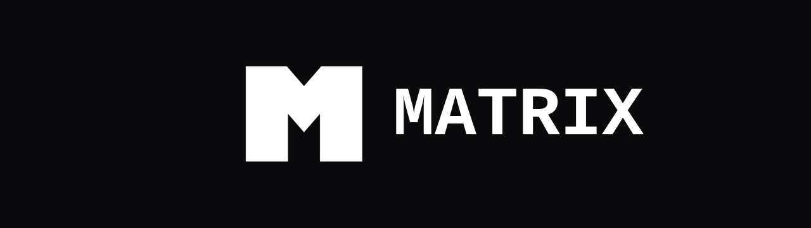
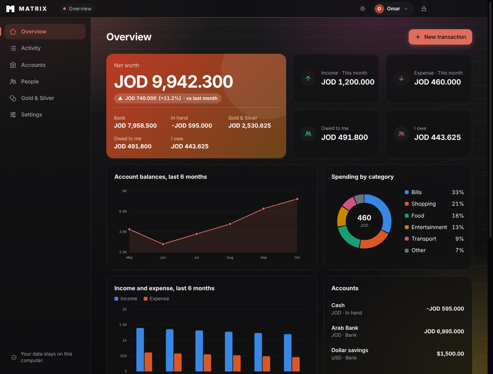
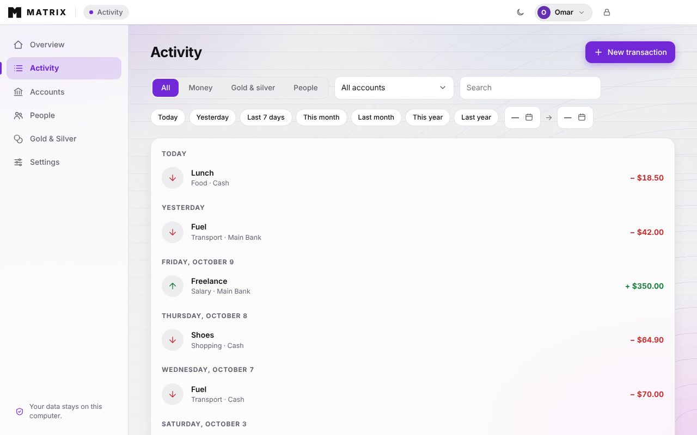

[README.md](https://github.com/user-attachments/files/33311483/README.md)
[README.md](https://github.com/user-attachments/files/33311496/README.md)
<p align="center">
  
</p>

<p align="center">
  <b>A private personal finance app for Windows.</b><br>
  Your money, your gold, your debts — all on your own PC. Nothing is ever sent online.
</p>

<p align="center">
  
  
  
  
</p>

<p align="center">
  <a href="../../releases/latest"><b>⬇ Download for Windows</b></a>
</p>

---

## Screenshots

<p align="center">
  
  
</p>

## Features

| | |
|---|---|
| 🏦 **Accounts** | Bank accounts and cash in hand, in JOD, USD and EUR. Income, expenses and transfers. |
| 🥇 **Gold & silver** | Buy and sell in grams with purity, average cost and profit. Built-in purity converter (24K → 21K, 18K). |
| 🤝 **People** | A ledger of who owes you and whom you owe, in money or gold. |
| 📊 **Charts** | Net worth, income vs expense, and spending by category. |
| 🔎 **Activity search** | Search and filter by type, account and date range, with quick shortcuts: today, yesterday, this month, this year, last year. |
| 👥 **Multiple users** | Each user has separate data, with an optional password that really encrypts it (AES-256). |
| 🌗 **Light & dark** | Plus a colour wheel that tints the buttons and highlights. |
| 🌍 **English & Arabic** | Full right-to-left layout in Arabic. |
| 📤 **Export & backup** | CSV export and JSON backup and restore. |

## Privacy

All data stays in your Windows user profile (`%APPDATA%\Ledger`). There are no accounts, no servers and no tracking. If you set a password and forget it, the data cannot be recovered. Backups are plain JSON, so keep them somewhere safe.

## Install

1. Open the [latest release](../../releases/latest).
2. Download the installer (or the portable `.exe`).
3. Run it. If Windows SmartScreen warns you because the app is unsigned, click **More info → Run anyway**.

## Build it yourself

You need [Node.js](https://nodejs.org) (LTS).

```bash
npm install
npm start        # try it
npm run dist     # build the installer into dist/
```

## Made by

[**mio-git-a-bit**](https://github.com/mio-git-a-bit)

Released under the [MIT License](LICENSE).

